# AI/SW 개발 워크스페이스 구축 미션

## 1. 프로젝트 소개

이 저장소는 코디세이의 **「내 컴퓨터에 개발자용 작업실 꾸미기」** 미션 수행 결과를 정리한 것입니다. Windows에서 터미널과 파일 권한을 실습하고, Docker 컨테이너 및 NGINX 기반 웹페이지 실행, 바인드 마운트와 볼륨 데이터 영속성을 확인했습니다. Git으로 버전관리를 시작하고 GitHub에 코드와 증거를 제출합니다.

> **실습 환경 안내:** 이 README의 Docker 실행 결과와 스크린샷은 **집 PC**에서 수행한 기록입니다. 코디세이 교육장 PC에서는 Docker 설치/실행이 되지 않아 같은 실습을 재수행하지 않았습니다. 교육장 PC에서 작성하는 GitHub 제출용 파일은 집 PC 실습에 사용한 코드와 동일한 내용을 재작성한 것입니다.

## 2. 실행 환경

| 항목 | 확인된 내용 |
|---|---|
| 운영체제 | Windows 10 Pro (집 PC) |
| 명령 실행 | Windows PowerShell / Docker 컨테이너 내부 Ubuntu Bash |
| Docker CLI | 29.9.2 (집 PC 캡처 기준) |
| Docker Server | 29.9.2 |
| Docker 실행 | Docker Desktop, Linux 컨테이너, WSL2 커널 `6.18.40.1-microsoft-standard-WSL2` |
| Git | 2.56.0.windows.4 (집 PC 캡처 기준) |
| 코드 편집기 | Visual Studio Code |

증거: [Docker 버전·실행 환경](screenshots/10_docker_info.jpg), [Git 버전 및 설정](screenshots/16_git_config_redacted.jpg)

## 3. 수행 항목 체크리스트

- [x] Docker 설치 및 Docker 엔진 확인 (`docker --version`, `docker info`)
- [x] `hello-world` 실행
- [x] Ubuntu 컨테이너 실행, 터미널 명령, 파일·폴더 생성
- [x] 파일 및 폴더 권한 변경 (`chmod 600`, `chmod 700`)
- [x] 컨테이너 목록, 이미지, 로그, CPU·메모리 사용량 확인
- [x] 컨테이너 종료 및 재시작, 기존 파일 유지 확인
- [x] NGINX 기반 Dockerfile 작성 및 이미지 빌드
- [x] 포트 매핑 (`8080:80`) 후 브라우저 접속
- [x] 바인드 마운트로 `index.html` 수정 반영 (`8082:80`)
- [x] Docker 볼륨에 저장 후 컨테이너 삭제 전후 데이터 유지 확인
- [x] Git 사용자 이름·이메일·기본 브랜치(main) 설정
- [ ] VS Code의 GitHub 계정 연결 **(최종 확인 및 증거 추가 필요)**
- [ ] GitHub 원격 저장소 생성·업로드·제출 링크 확인 **(완료 후 체크)**

## 4. 터미널 조작, 폴더 및 권한 실습

Ubuntu 컨테이너를 실행한 뒤 다음 명령을 입력했습니다.

```bash
docker run -it --name mybox ubuntu
# Ubuntu 안에서:
pwd
ls -la
mkdir temp
cd temp
touch file.txt
mkdir mydir
ls -l
chmod 600 file.txt
chmod 700 mydir
ls -l
```

`pwd`는 현재 경로, `ls -la`는 숨김 항목을 포함한 상세 목록을 보여줍니다. `chmod 600`은 파일 소유자에게 읽기(4)와 쓰기(2)를, `chmod 700`은 폴더 소유자에게 읽기(4)·쓰기(2)·접근/실행(1)을 허용합니다. 나머지 사용자에게는 권한을 주지 않습니다.

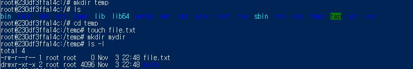

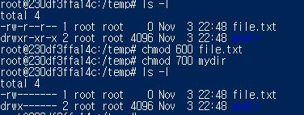

추가로 파일 내용 확인, 복사, 이름 바꾸기, 삭제도 실행했습니다.

```bash
cd /temp
echo "hello from ubuntu" > file.txt
cat file.txt              # hello from ubuntu
cp file.txt copy.txt
ls -l
mv copy.txt renamed.txt
ls -l
rm renamed.txt
ls -la
```

`cat /temp/file.txt`와 같은 **절대 경로**는 현재 위치와 관계없이 `/`에서 시작하고, `cat file.txt`와 같은 **상대 경로**는 현재 폴더를 기준으로 합니다. `mkdir mydir`에서 `mydir`은 디렉터리, `file.txt`는 파일입니다.

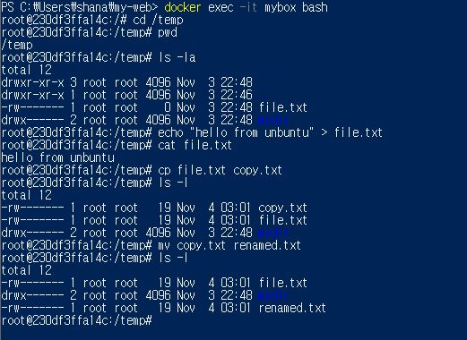

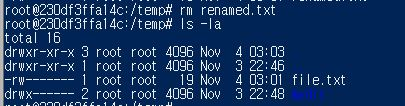

## 5. Docker 설치 및 기본 동작 검증

```powershell
docker --version
docker info
docker run hello-world
docker ps -a
```

실행 결과에 `Hello from Docker!`가 출력되어 Docker 이미지를 내려받고 컨테이너를 생성·실행할 수 있음을 확인했습니다.

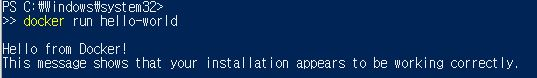

Docker 이미지는 컨테이너 실행에 필요한 파일과 설정의 묶음이고, 컨테이너는 이미지를 바탕으로 만들어진 실행 인스턴스입니다.

## 6. 컨테이너 상태 및 운영 정보 확인

```powershell
docker ps
docker ps -a
docker images
docker logs mybox
docker stats --no-stream
```

`docker ps`는 실행 중인 컨테이너, `docker ps -a`는 종료된 컨테이너까지 포함한 목록을 보여줍니다. `docker images`는 이미지 목록, `docker logs`는 표준 출력·오류 로그, `docker stats --no-stream`은 한 번의 자원 사용량 정보를 보여줍니다.

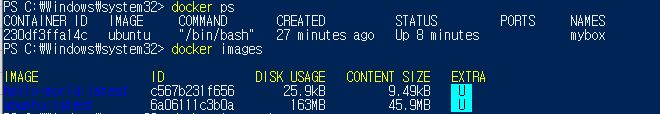

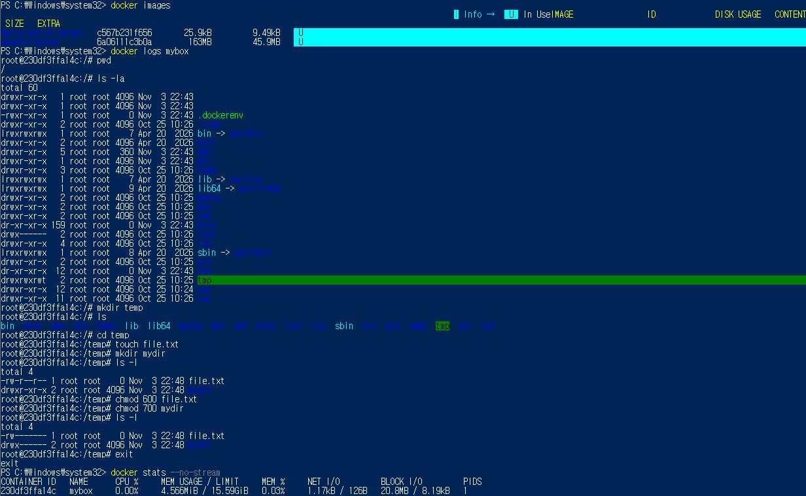

컨테이너를 중지했다가 다시 실행했습니다.

```powershell
docker stop mybox
docker ps -a
docker inspect mybox --format '{{.State.OOMKilled}}'
# OOMKilled: false
docker start mybox
docker ps
```

실제 중지 화면에는 `mybox`가 **`Exited (137)`**로 표시되었습니다. 이는 일반적으로 강제 종료를 뜻하며 정확한 원인은 확인되지 않았습니다. `OOMKilled: false`였으므로 Docker의 메모리 부족 종료 기록은 없었습니다. 재시작 뒤에는 **`Up`** 상태를 확인했습니다. 코드 137을 정상 종료 코드 0으로 바꾸어 기록하지 않았습니다.

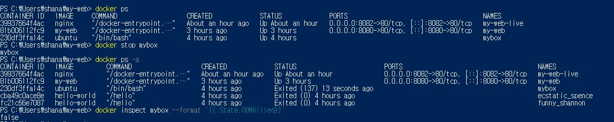

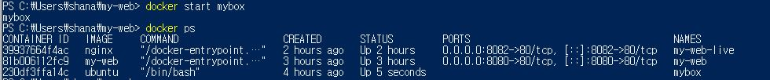

이전 `mybox` 컨테이너에 다시 들어가 `/temp` 안의 파일과 폴더가 유지됨도 확인했습니다. 단, 컨테이너를 삭제하면 그 안에 직접 저장한 데이터는 사라질 수 있습니다.

## 7. Dockerfile 기반 웹 서버 이미지 만들기

사용한 기존 베이스 이미지는 `nginx`입니다. 별도 서버 프로그램을 처음부터 개발하지 않고, 웹서버의 기본 정적 페이지를 **내가 만든 `index.html`로 교체**하는 것이 커스텀 포인트입니다.

**Dockerfile**

```dockerfile
FROM nginx
COPY index.html /usr/share/nginx/html/index.html
```

**빌드와 실행**

```powershell
# Dockerfile과 index.html이 있는 폴더에서
docker build -t my-web .
docker images my-web
docker run -d -p 8080:80 --name my-web my-web
docker ps
```

`docker build` 로그에 `FINISHED`가 나타나고 `my-web:latest` 이미지가 목록에 표시됐습니다. `localhost:8080`의 브라우저에서도 직접 만든 페이지가 보였습니다. `-p 8080:80`은 Windows 컴퓨터의 8080번 포트를 컨테이너 웹서버의 80번 포트로 연결한다는 뜻입니다.

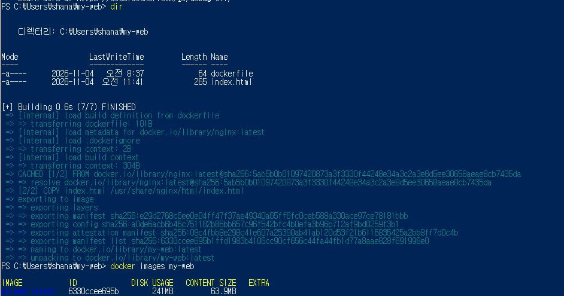

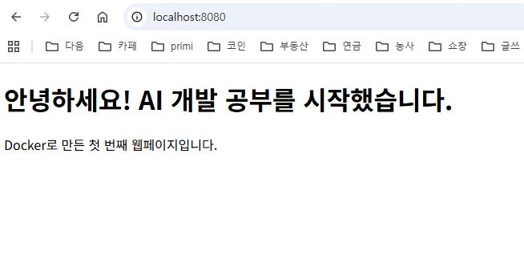

## 8. 바인드 마운트 수정 반영 실습

```powershell
# Windows PowerShell, my-web 폴더에서
docker run -d -p 8082:80 --name my-web-live -v "${PWD}:/usr/share/nginx/html" nginx
```

호스트 PC의 작업 폴더를 컨테이너 안 NGINX 웹페이지 폴더와 연결했습니다. `index.html`의 `<h1>` 제목을 원래 **“안녕하세요! AI 개발 공부를 시작했습니다.”**에서 **“바인드 마운트 수정 성공!”**으로 변경하고 저장한 뒤, 이미지를 다시 빌드하지 않고 `localhost:8082`를 새로고침하여 변경을 확인했습니다.

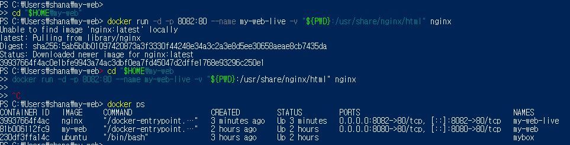

| 수정 전 | 수정 후 |
|---|---|
| 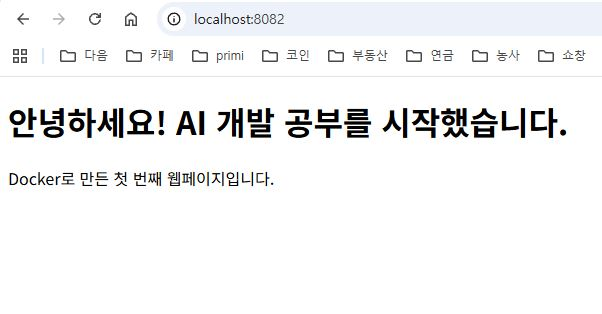 | 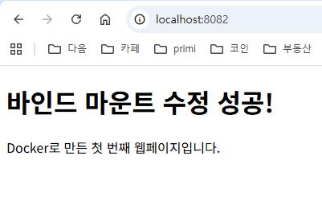 |

## 9. Docker 볼륨 데이터 영속성 검증

볼륨 이름은 `mydata`입니다. PowerShell의 따옴표 처리 문제를 피하기 위해 `echo | tee` 방식으로 파일을 저장했습니다.

```powershell
docker volume create mydata
echo 'hello volume' | docker run --rm -i -v mydata:/data ubuntu tee /data/memo.txt
# hello volume

docker run --rm -v mydata:/data ubuntu cat /data/memo.txt
# hello volume
```

`--rm`으로 첫 임시 컨테이너가 삭제된 뒤에도 새 컨테이너에서 같은 내용을 읽을 수 있었습니다. 증거를 분명히 하기 위해 별도 컨테이너를 생성·삭제하여 다시 확인했습니다.

```powershell
docker volume ls
docker run --name vol-proof -v mydata:/data ubuntu cat /data/memo.txt
# hello volume
docker rm vol-proof
# vol-proof
docker run --rm -v mydata:/data ubuntu cat /data/memo.txt
# hello volume
```

즉 **컨테이너 삭제 이후에도 이름 있는 볼륨은 별도로 유지**됐습니다.

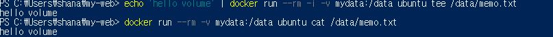

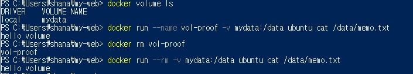

## 10. Git 설정, GitHub 연결

집 PC에서 Git 설치와 기본 설정을 완료했습니다.

```powershell
git --version
# git version 2.56.0.windows.4
git config --global user.name "(설정한 사용자 이름)"
git config --global user.email "(설정한 이메일 주소)"
git config --global init.defaultBranch main
git config --global --list
```

사용자 이름·이메일·`main` 브랜치 설정 결과는 캡처로 확인했습니다. **개인 이메일은 공개 제출용 사진에서 가렸습니다.**

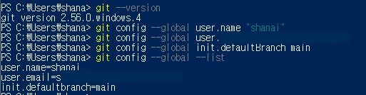

**Git과 GitHub 차이:** Git은 내 컴퓨터에서 작업 이력을 관리하는 도구이고, GitHub는 Git 저장소를 온라인에 저장하고 공유하는 플랫폼입니다.

> **아래는 교육장 PC에서 완료 후 업데이트할 항목입니다.**
> - [ ] VS Code에서 GitHub에 로그인한 것을 확인하고 로그인/연동 증거 캡처
> - [ ] 이 폴더를 Git 저장소로 초기화하고 커밋
> - [ ] GitHub 저장소 생성 및 파일 업로드
> - [ ] 저장소 링크를 과제 제출처에 제출

## 11. 트러블슈팅 (실제 발생한 문제)

### 사례 A. BIOS 가상화 비활성화로 Docker Engine 미실행

- **문제:** Docker Desktop에서 `Virtual Machine Platform is not enabled`, 이어서 하이퍼바이저 미작동 및 BIOS 하드웨어 가상화 비활성화 메시지가 나왔습니다.
- **원인 가설:** 메인보드 UEFI의 Intel Virtualization Technology가 꺼진 상태였습니다.
- **확인 및 해결:** BIOS 설정의 CPU 관련 메뉴에서 가상화 기능을 활성화하고 Windows를 재시작했습니다.
- **검증 결과:** Docker Desktop의 Engine running과 `docker run hello-world` 성공을 확인했습니다.

### 사례 B. WSL 버전이 오래되어 Docker 실행 실패

- **문제:** `Your version of Windows Subsystem for Linux (WSL) is too old.` 메시지가 나왔습니다.
- **원인 가설:** Docker Desktop에서 요구하는 WSL 버전이 설치된 버전보다 새 버전이었습니다.
- **확인 및 해결:** `wsl --update`를 안내받아 WSL을 업데이트했습니다. 이후 BIOS 가상화 설정도 함께 바로잡았습니다.
- **검증 결과:** WSL2 환경에서 Docker Engine이 실행됐고 `docker info`, `docker run hello-world`를 수행했습니다.

### 사례 C. PowerShell 명령을 완성하지 못해 `>>` 표시가 반복됨

- **문제:** `cd "$HOME\my-web` 명령에서 마지막 큰따옴표를 누락해 명령이 끝나지 않았습니다.
- **원인:** 문자열의 닫는 따옴표가 없었습니다.
- **해결:** `Ctrl + C`로 입력을 취소하고 올바른 명령을 사용했습니다.
- **검증:** PowerShell 기본 프롬프트로 복귀해 기존 컨테이너의 `Up` 상태와 8082 페이지 접속을 확인했습니다.

## 12. 다시 실행하는 방법

Docker가 준비된 PC에서 프로젝트 폴더로 이동해 다음 명령으로 이미지를 만들고 실행할 수 있습니다.

```powershell
docker build -t my-web .
docker run -d -p 8080:80 --name my-web my-web
```

웹브라우저에서 `http://localhost:8080`을 엽니다. 이미 `my-web`이라는 컨테이너가 존재한다면 먼저 상태를 확인해야 하며, 같은 이름으로 중복 생성하지 않습니다. 8080 포트가 사용 중이라면 사용하지 않는 포트로 변경할 수 있습니다.

## 13. 결론

Docker를 이용해 동일한 웹서버 실행 환경을 구성하고, 포트 매핑으로 브라우저에서 접속하는 과정을 경험했습니다. 바인드 마운트는 개발 중 코드 변경을 빠르게 반영하고, 볼륨은 컨테이너 수명과 분리해 데이터를 유지하는 데 유용하다는 점을 확인했습니다. Git/GitHub는 이러한 코드를 기록하고 제출·공유하는 마지막 단계입니다.
